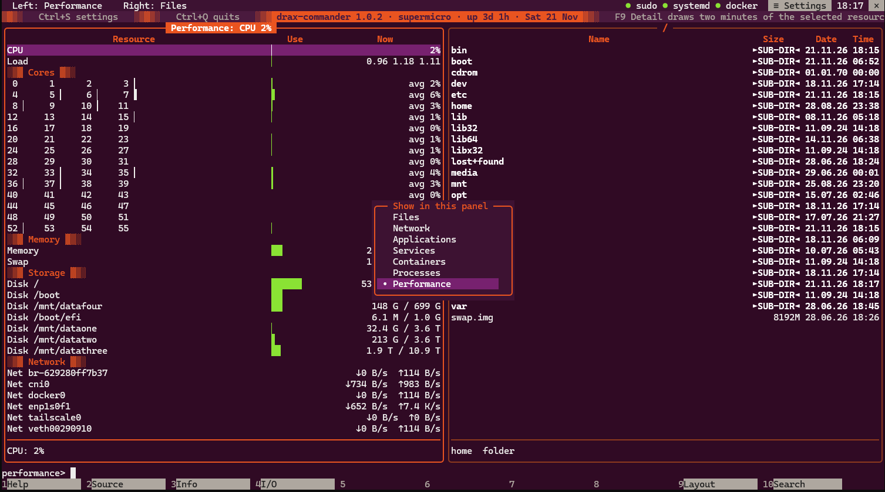
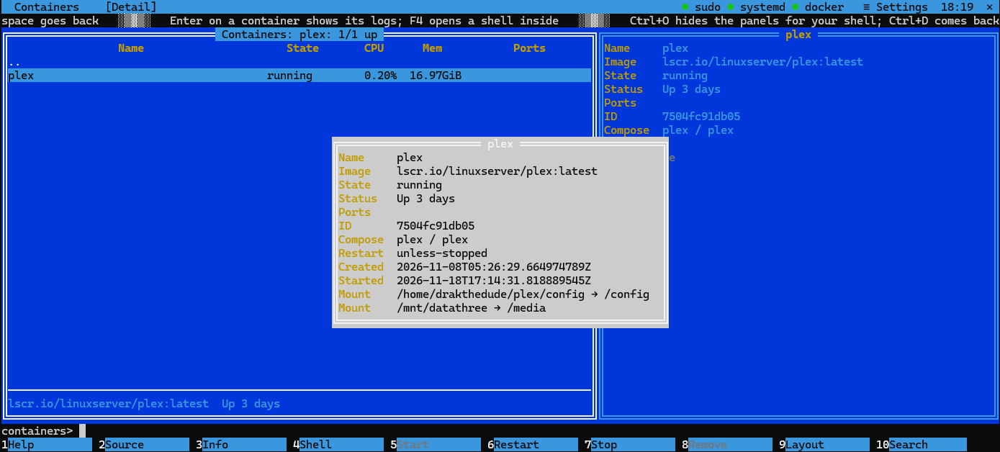
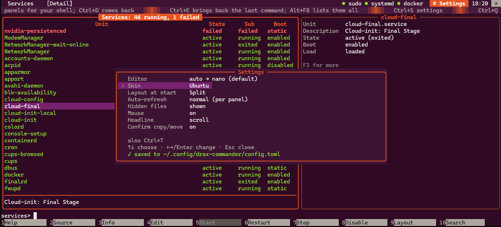

# drax-commander

A two-panel terminal workspace for Ubuntu and Debian, in the Norton Commander tradition: a menu
bar, two panels, a live command line and an F-key bar. The panels are not just files. Each one
can show files, network shares, installed applications, systemd services, Docker containers,
processes or a performance monitor, and the F-keys change to match what is selected.

It runs in any terminal, including over SSH, and works with the keyboard or the mouse.



## Install

Download the `.deb` for your machine from [Releases](../../releases/latest): `amd64` for most
PCs and servers, `arm64` for ARM boards and servers. Then, from the folder you saved it in:

```bash
cp drax-commander_*_amd64.deb /tmp/ && sudo apt install /tmp/drax-commander_*_amd64.deb
```

(Copying to `/tmp` first only avoids a harmless apt notice about files in your home folder.)

Start it with `drax-commander`, or from your desktop's app menu.

**Upgrade:** install the newer `.deb` the same way.
**Remove:** `sudo apt remove drax-commander`

Needs Ubuntu 22.04 or newer, or Debian 12 or newer.

## The first five minutes

| key | does |
|---|---|
| Tab | switch between the two panels |
| Enter | open a folder, run an app, show a service's or container's logs |
| Backspace | up one folder |
| F1 | help: every key, in the app |
| F2 | choose what this panel shows |
| F3 | everything known about the selected item |
| F4–F8 | actions for the selected item; they change per panel and per item |
| F9 | layout: two panels, one wide panel with a live details pane, or one panel |
| F10 | search: type to filter the panel |
| Ctrl+O | hide the panels and use your shell; Ctrl+D brings them back |
| Ctrl+S | settings |
| Ctrl+Q or × | quit |

Anything typed and run with Enter goes to your shell, in the panel's folder.

**Two presses for anything destructive.** Delete, stop, kill, unmount: the first press arms
it (the row and key turn red), the same key again does it, any other key cancels. Deleting a
folder first measures it and shows what would go (files, size, the largest ones), and only
**D** deletes.

## Panels

- **Files:** copy (F5) and move (F6) through a "Copy X to:" dialog that never overwrites
  without asking; F7 new folder; F8 delete; F4 edit in your editor; Ctrl+F find by name. Mark
  several items with Insert (or `+` and a pattern such as `*.log`) and copy, move or delete
  them together.
- **Network:** type `\\server\share` (or `smb://server/share`) in the command line to open a
  network share; it is mounted for you if needed. The Network panel lists mounted and recent
  shares, and F8 unmounts.
- **Applications:** run (F5), edit a launcher (F4), uninstall (F8).
- **Services:** start, restart, stop, enable or disable systemd units; Enter shows the logs; F4
  edits through an override.
- **Containers:** Docker containers grouped by compose project; logs, a shell inside, start,
  restart, stop, remove.
- **Processes:** sort by CPU or memory; F8 asks a process to stop, F7 forces it.
- **Performance:** CPU per core, memory, disks with their read/write, network. F9 shows a live
  graph of the selected one. On WSL it also shows the Windows PC itself: its CPU, all of its
  memory, and its drives.

Every action checks the result afterwards and says what is now true, not just that a command
ran.

## Screenshots

**Containers** in the Classic skin: a compose project opened, with F3 showing the container's
image, restart policy and mounts.



**Services** with the settings open (Ctrl+S): a failed unit at the top in red, the selected
unit's details on the right.



## Settings

Ctrl+S (or click **≡ Settings**): your editor, the skin (Ubuntu or Classic Norton Commander
blue), the layout at start, how often panels refresh, hidden files, mouse, the headline bar, and
whether copy and move ask first. They are saved in `~/.config/drax-commander/config.toml`.

## Feedback

Petr Draxler <petrdraxler@gmail.com>

## License

Free to use, at home or at work, and to pass on unmodified. It may not be sold, modified or
reverse engineered. See [LICENSE](LICENSE). The open-source components it includes keep their
own licenses, listed in [THIRD-PARTY-LICENSES](THIRD-PARTY-LICENSES) (also installed in
`/usr/share/doc/drax-commander/`).
